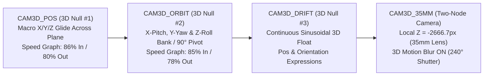
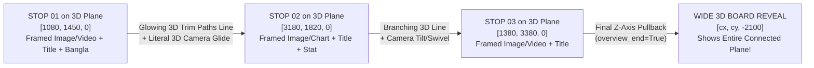

# ANAN MASTER EDIT STYLE BIBLE — 2025–2026 3D Spatial Camera Plane & FinTech Motion Design System
### Reverse-Engineered from Keanu Visuals, Capitaojack, Devin Jatho, Iman Gadzhi, Umar Ashraf / TradeZella, TJR, and MagnatesMedia (`2160×3840 @ 25fps`)

> **CRITICAL DIRECTIVE FOR CLAUDE & EDITORS:**
> 1. **NEVER use legacy homemade styles** (`LucidaHandwriting`, `Magneto-Bold`, `Impact`, thick `16px` white stickers) **AND NEVER use generic Windows system fonts** (`Times New Roman`, `Consolas`, or decorative brush Bangla fonts like `Li Shadhinata` for UI).
> 2. **Use the 2025–2026 Motion-Designer Font Stack** installed in `%LOCALAPPDATA%\Microsoft\Windows\Fonts` & `E:\Anan\Assets\Fonts` (`PlusJakartaSans-ExtraBold`, `Syne-ExtraBold`, `Anton-Regular` / `BebasNeue-Regular`, `InstrumentSerif-Italic`, `JetBrainsMono-ExtraBold`, and `HindSiliguri-Bold`).
> 3. **Use the "Moving in a 3D Plane" After Effects Spatial Motion Graphics System (`ae3d.py` & `aecards.py`):** Instead of flat 2D text/cards popping in and out on a static screen, elements live on a **3D World-Space Plane (`threeDLayer = true`)** navigated by a **4-Node 3D Camera Rig (`CAM_POS` $\rightarrow$ `CAM_ORBIT` $\rightarrow$ `CAM_DRIFT` $\rightarrow$ `CAM_35MM`)** that glides, banks (`Z-Roll`), tilts (`X-Pitch` / `Y-Yaw`), pivots `90°`, and flies through Z-space across an **Infinite 3D Perspective Grid Plane**!

---


## 00. WHAT ACTUALLY WORKS ON HIS ACCOUNTS (data, 9-11-2026 - overrides every rule below where they clash)
Measured on YouTube @Anan Zarif (UCS-w2l0-AH24d-LFFmhcinQ) and TikTok @quotexbull (107K followers, 1.1M likes):
- **Winners:** TikTok "TRADING STRATEGY" 157K, "Just 2 Thousand" 127K, "100% sure shot" 95K, "Per day 500-1000" 87K,
  "Trading takes time" 87K, "ONLY 500 TAKA" 78K, "Trading is mind game" 69K; YouTube "It's time" 6.9K, "ঈদে ফ্যামিলির
  জন্য কি করেছ" 6.4K, "Money Bag ভরা, Charts এখনো খোলা" 5.5K, "টাকা ছাড়া তুমি শতভাগ অসুখী" 4.8K, "Trading life" 4.1K.
- **Losers:** the heavily designed Nov-2026 reels (3D HUD flowcharts, ChatGPT prompt bars, blueprint-grid cards, one
  English keyword per second, 44-87 s): 20-230 views on both platforms - the lowest on the account.
**The winning recipe:**
1. **30-40 s** (talking) or **9-21 s** (lifestyle POV to music). Never 60-90 s.
2. **A FIXED HEADER for the whole video** in the top bar: one concrete money / value promise in big bold Bangla or
   short English - "ট্রেডিং শিখুন ১ মিনিটে" (red on black), "২ হাজার -> 30-40 হাজার" (green), "99% Failure" (green),
   "How to make money?" (green), "POV: MONEY BAG FULL". Said and shown in the first 2 s; the topic (trading / taka /
   the number) is in frame 1.
3. **Simple, credible look:** him at his trading desk with charts behind him (or the chart itself), plain big text,
   NUMBERS in green, warnings in red, Bangla captions low. B-roll only literal and fast (1-2 s): money, chart, stressed
   trader. NO 3D boards / HUD flowcharts / ChatGPT UI / blueprint-grid cards / per-second English keyword spam - they
   read as an ad template and get swiped.
4. **Lifestyle POV shorts** (cash on the desk + chart, airport, travel; music, no voice, one POV header) are a second
   winning format - cut them from his own clips.
5. **Titles:** specific Bangla money / emotion line ("এবারের ঈদে ফ্যামিলির জন্য কি করেছ?"), not generic English +
   hashtag spam.
7. **Implementation (HC v2, template default):** `h.header(line1, line2)` = fixed black bar y 190-650 for the
   whole reel, line 2 the big punchline (keep lines SHORT - long lines shrink to fit 1960 px); `h.num(t0, t1, txt)` =
   green/red number pop at y 880 (reelkit DROPS any non-caption text at y 900-1700 without a cut-out - the
   behind-head lane); `h.burst_at(t, "money"|"fire")` on the first money word; captions from frame 1; 1-2 s literal
   cutaways only; no steps / top keywords / grid cards (they collide with the header and read as a template).
6. **Compliance:** keep concrete numbers but as his team's results / a challenge - not "100% sure shot" or "per day X"
   guarantees (platform fraud policy).

## 0. HOUSE RULES (2026-11, from Anan's review — these override anything below)

1. **Fast-cut version by default.** Follow VIRAL_PHILOSOPHY Beat 2/3: a visual reset every ~2 s. Talking head alone for more
   than ~3 s is too bland. Rotate: face + behind-head word -> stock card -> full-screen stock -> 3D plane -> face punch.
2. **Exact Spoken-Word & Emotional Stock B-Roll** (index: `references/stock.md` + auto-downloader `scripts/stock_fetch.py`). Every pointer, metaphor, example, or emotion MUST match the literal spoken word (e.g. gym weights for gym, roulette wheel for gambling, hourglass for patience, mobile gamer for PUBG). If `references/stock.md` lacks a dark-lit live-action match, run `python scripts/stock_fetch.py "<query>" --orientation portrait|landscape --download --limit 1 --use-for "<tags>"` to pull from Pexels/Pixabay into `E:\Anan\Assets`.
3. **Text = 3-4-word CHUNKS on the word.** Group the spoken line into chunks of 3-4 words; each chunk lands on its first word
   and is replaced by the next (`r.chunks([(W(i,k), "তিন চার শব্দ"), (W(i,k2), "পরের চাংক", "bn_g"), ...], y=LOW)`).
   Write the Bangla correctly (fix Whisper's spelling), English trading terms in English. Highlight the key chunk in
   green/gold/red. Keep single big behind-the-head words only for the 3-5 biggest beats.
   Put chunks at TOP (y 600) while a card/answer card sits on the chest, and at LOW otherwise; no chunks over a 3D board.
   Never use `৳` in Latin fonts (`JetBrainsMono`/`PlusJakartaSans`) — write `TK ` so fallback glyphs never collide.
4. **No stroke & `Accepts Lights = 0` on text that lives on a 3D plane** (boards, cards, plane typography): clean fill + drop shadow only so point lights never blow out Bangla matras.
5. **Rotate across the 5 Distinct 3D Camera Variations — NEVER repeat only `plane_canvas`:**
   - `r.plane_canvas` (FinTech Mind-Map Board with 98px header strip) — multi-step technical chains.
   - `r.plane_tunnel` (3D Z-Depth Fly-Through Corridor over `+84°` floor grid) — timelines, `2026 -> 2027`, roadmaps.
   - `r.plane_hub` (Central Double-Ring Core Hub + Radiating Spoke Satellites) — 1 core rule governing 3 areas/options.
   - `r.plane_versus` (Opposing Angled V-Stage Monoliths + Center Verdict Bridge) — binary comparisons & `1:2 RR`.
   - `r.plane_kinetic` (Box-Free 3D Architectural Typography with `90°` Camera Z-Pivots) — punchy hooks & life lessons.
6. **Neon outline overlays (`aecards.neon`) with exact baseline math:**
   - For step/pillar numbers inside a spinning ring, ALWAYS use single concentric `neon(r, C, t0, t1, "badge_num", 1750, 560, size=360, color=..., text="1")` (`y=560` stays safely above `BEHIND=1020`).
   - Remember AE text `y` is the **baseline**: an `underline` goes at `y_text + 75`; a `box` around `mono_hero` at `y=2700` centers at `y=2615`.
7. **Zero-vocal instrumental music beds ONLY** (`E:/Anan/Assets/Music/*.mp3` with pure ASCII filenames and `music_src_in` set right on the atmospheric swell, `-21` to `-23 dB`). Never use English rap/singing vocals or harsh opera choirs over Bangla voiceover.
8. **Catch half-said false starts** (`false_starts.py`), not just full-phrase retakes.

## 1. The 2025–2026 FinTech & 3D Spatial Color System

Every 3D plane, glass UI node, kinetic word cluster, and chart vector obeys a strict **6-Color Semantic Palette**:

| Semantic Role | Hex | AE Normalized RGB (`0.0–1.0`) | Where It Appears on the 3D Plane |
|---|---|---|---|
| **1. Obsidian Spatial Void (Base Plane)** | `#06090F` / `#0A0F1A` | `[0.04, 0.06, 0.10]` | Deep 3D world floor (`3D_VOID`), Frosted Glass card bodies (`92–95%` opacity), and darkened vignette backing |
| **2. Crisp Titanium White (Neutral Authority)** | `#F8FAFC` | `[0.97, 0.98, 0.99]` | Primary `PlusJakartaSans-ExtraBold` / `Syne-ExtraBold` / `HindSiliguri-Bold` setup words and card titles |
| **3. Alpha Profit Emerald (Bullish / Win / Skill)** | `#00E676` | `[0.00, 0.90, 0.46]` | Profit counters (`+$4,200`), `1:4 RR` target zones, `Trim Paths` bullish conduits, and Bangla profit/skill words (`প্রফিট`, `স্কিল`, `টাকা`, `সাকসেস`) |
| **4. Liquidation Crimson (Stop-Loss / Trap / Pain)** | `#FF1E42` | `[1.00, 0.12, 0.26]` | Loss figures (`-$500`, `95% FAIL`), stop-hunt sweeps, `Trim Paths` X-strikes, and Bangla warning/loss words (`লস`, `ফাঁদ`, `ভুল`, `স্ক্যাম`, `ধ্বংস`) |
| **5. Sovereign Editorial Gold (Status / Mindset / Contrast)** | `#F59E0B` | `[0.96, 0.62, 0.04]` | `InstrumentSerif-Italic` luxury editorial accent words, crown/mindset callouts (`মাইন্ডসেট`, `স্বপ্ন`, `ফ্রিডম`) |
| **6. Spatial Telemetry Cyan & Slate (3D Grid & HUD)** | `#38BDF8` / `#94A3B8` | `[0.22, 0.74, 0.97]` / `[0.58, 0.64, 0.72]` | 3D perspective grid lines (`ADBE Grid`), `+` coordinate crosshairs, `[ NODE 01 // M15 ]` pills, and subtle `5px` glass borders |

---

## 2. The 2025–2026 Motion-Designer Font Stack (Installed & Verified)

All fonts below are installed as static TTFs in `C:\Users\btaza\AppData\Local\Microsoft\Windows\Fonts` and backed up in `E:\Anan\Assets\Fonts`, wired directly into [`reelkit.py`](file:///C:/Users/btaza/.claude/skills/shorts-editor-skill/scripts/reelkit.py), [`ae3d.py`](file:///C:/Users/btaza/.claude/skills/shorts-editor-skill/scripts/ae3d.py), and [`aecards.py`](file:///C:/Users/btaza/.claude/skills/shorts-editor-skill/scripts/aecards.py):

### 2.1 The 5-Font Hierarchy (`2160×3840` Vertical 4K Canvas)

| Role | PostScript Name (`reelkit.py` / AE) | `reelkit.py` Style Tokens | Size (`2160×3840`) | Tracking & Styling Rules |
|---|---|---|---|---|
| **1. Primary FinTech & Kinetic Sans** | `PlusJakartaSans-ExtraBold` & `PlusJakartaSans-Bold` | `sans_w`, `sans_g`, `sans_r`, `sans_gold`, `sans_cyan` | `320px–390px` (Kinetic)<br>`70px–118px` (3D UI Cards) | Tracking `-25`. Razor-sharp modern geometric sans (used by Stripe/Linear/Framer). Clean vector outlines for 3D plane extrusions and fast scale pops. |
| **2. Architectural Hero & Pillar Display** | `Syne-ExtraBold`, `Anton-Regular`, `BebasNeue-Regular` | `sans_hero` (`Syne-ExtraBold`), `sans_slam` (`Anton-Regular`), `pillar_w` (`BebasNeue-Regular`) | `450px–560px` | `Syne-ExtraBold` (Tracking `-35`) for wide avant-garde motion-designer statements; `Anton-Regular` / `BebasNeue-Regular` for tall `BEHIND (1300)` occluded titles behind Anan's RVM cutout. |
| **3. Neo-Luxury Editorial Serif Italic** | `InstrumentSerif-Italic` | `serif_gold`, `serif_w`, `serif_g` | `340px–400px` | Tracking `-10`, lowercase or Title Case. Placed directly beside `PlusJakartaSans-ExtraBold` (`sans_w("THE")` + `serif_gold("illusion")`) for Mercury / Iman Gadzhi luxury editorial contrast. |
| **4. Quant HUD & Tabular Monospace** | `JetBrainsMono-ExtraBold` & `JetBrainsMono-Bold` | `mono_g`, `mono_r`, `mono_w`, `mono_hero`, `label_slate` | `310px–480px` (Counters)<br>`44px–60px` (3D HUD Pills) | Zero-jitter tabular numerals for all `$USD / ৳BDT` counters, percentages (`95%`), RR ratios (`1:4.0 RR`), and 3D plane coordinates (`+ SYS.PLANE // X:1080 Z:-240`). |
| **5. Modern Geometric UI & Kinetic Bangla** | `HindSiliguri-Bold` & `HindSiliguri-SemiBold` | `bn_w`, `bn_g`, `bn_r`, `bn_gold`, `bn_hero` | `330px–430px` (Kinetic)<br>`85px–118px` (3D Nodes) | `composerEngine="universal"`. Monolinear, flat-terminal geometric Bangla engineered for digital UI and 3D motion graphics (never muddies during 3D camera motion blur). |

---

## 3. Comprehensive After Effects 3D Camera Plane & Spatial Motion Graphics Architecture ("Moving in a Plane")

What keeps viewers hypnotized in top 2025–2026 motion-design reels (**Keanu Visuals, Capitaojack, Devin Jatho, Iman Gadzhi, Ali Abdaal's AE team**) is that the screen is treated as a **window into a continuous 3D Plane (`X, Y, Z` World Space)**. Instead of elements popping in and out on a dead 2D frame, **an After Effects 3D Camera physically travels across the plane** from element to element.

### 3.1 System 1 — The 4-Node Hierarchical 3D Camera Rig (`ae3d.camera_rig_3d`)

Never keyframe an After Effects Camera layer directly (which causes gimbal lock and jerky curves). Every 3D plane sequence uses a **4-layer parented rig** in `2160×3840 @ 25fps`:



1. **`CAM3D_POS` (3D Null #1 — Planar Translation Controller):**
   - `threeDLayer: true`, starts at `[1080, 1920, 0]`.
   - Keyframes `Position` `[wx, wy, wz]` from Node 1 to Node $N$ across the plane.
   - **Graph Editor Law:** Every keyframe uses `inSpeed = 0, inInfluence = 86%` and `outSpeed = 0, outInfluence = 80%` (steep velocity hill in the middle of the move, magnetic cushioned lock onto the target node).
2. **`CAM3D_ORBIT` (3D Null #2 — Isometric Tilt, Swivel & Roll Bank Controller, parented to `CAM3D_POS`):**
   - Controls 3D angle of attack as the camera glides across the plane:
     - **`X Rotation` (Tabletop Pitch):** `+8°` to `+55°` (tilts the camera to look down across the 3D grid floor plane).
     - **`Y Rotation` (Perspective Swivel):** `-18°` to `+18°` (orbits around floating 3D glass cards and candlestick charts).
     - **`Z Rotation` (Momentum Roll Bank & 90° Pivot):** Banks `±3.5°` during fast horizontal whip-pans like a cinema FPV drone, OR whips `0° -> -90°` for kinetic text pivot turns on the plane!
3. **`CAM3D_DRIFT` (3D Null #3 — Continuous Floating Life, parented to `CAM3D_ORBIT`):**
   - Ensures the 3D plane **never freezes**, even while holding on a card or chart:
     - **Position Expression:** `var u=time-inPoint; value + [Math.sin(u*1.4)*26, Math.cos(u*1.1)*22, Math.sin(u*0.85)*36]`
     - **Orientation Expression:** `var u=time-inPoint; value + [Math.sin(u*0.95)*1.5, Math.cos(u*1.25)*2.0, Math.sin(u*0.75)*0.8]`
4. **`CAM3D_35MM` (35mm Cinema Camera, parented to `CAM3D_DRIFT`):**
   - Local `Position`: `[0, 0, -2666.7]` so any 3D layer at `[1080, 1920, 0]` is framed at exact `100%` 1:1 scale.

---

### 3.2 System 2 — The 3D Infinite Perspective Grid & Multi-Plane Z-Parallax (`ae3d.infinite_grid_plane`)

For the viewer's brain to perceive the camera "moving in a plane," there **must** be visible spatial reference planes at staggered Z-depths:

| Depth Plane | Z-Coordinate (`px`) | Layer Contents | Parallax Behavior During Camera Glide |
|---|---|---|---|
| **Plane 1: Deep Void & Infinite Grid** | `Z = +420px` to `+500px` | `6400×7600px` 3D Solid (`threeDLayer: true`) with native AE **`ADBE Grid`** (`Width: 160`, `Border: 2.5`, `Color: #94A3B8` at `22%` opacity, `Blending Mode: Add`) | Moves slowest in the background; sells the physical plane surface underneath all cards and text |
| **Plane 2: Glass Card / Chart Backplates** | `Z = 0px` to `+40px` | 3D Frosted Glass UI Cards (`#0A0F1A` fill at `94%` opacity, `6px` semantic border `#00E676` / `#FF1E42` / `#94A3B8`, `Roundness: 44–56px`, `Drop Shadow` `Dist: 36, Soft: 95`) | Primary focal plane locked by `CAM3D_POS` |
| **Plane 3: Elevated Card Content & Type** | `Z = -24px` to `-55px` | Card headlines (`PlusJakartaSans-ExtraBold` / `HindSiliguri-Bold`), `JetBrainsMono-ExtraBold` badges (`[ NODE 01 ]`), and `Trim Paths` checkmarks/X-marks | Hovers `24–55px` **in front of** the glass card surface; shifts visibly against the card background when `CAM3D_ORBIT` swivels! |
| **Plane 4: Foreground HUD Telemetry** | `Z = -180px` to `-280px` | Floating `JetBrainsMono-Bold` (`44px`, `42%` opacity) coordinate crosshairs (`+ SYS.PLANE // NODE.01 [X:1080 Z:-240]`, `+ LIQ.MATRIX // M15`) | Sweeps rapidly across the foreground lens with heavy `240°` motion blur during every camera glide |

---

### 3.3 System 3 — Spatial Waypoint Kinetic Typography (`ae3d.spatial_text_plane`)

Instead of spawning every phrase at the same 2D `[1080, 820]` coordinate, use **4 Spatial Plane Typography Movements**:

1. **Planar Waypoint Glide (`Cluster A [1080, 1920, 0]` $\rightarrow$ `Cluster B [2430, 1400, -220]`):**
   - Cluster A (`sans_w("95% TRADERS")`) is placed at `[1080, 1920, 0]`.
   - Cluster B (`sans_r("LOSE MONEY")` + `bn_r("টাকা নষ্ট করে")`) is placed `1350px` to the right and `520px` up on the 3D plane at `[2430, 1400, -220]`.
   - On the spoken beat of Cluster B, `CAM3D_POS` whips diagonally across the plane to `[2430, 1400, -220]` (`Orbit: [-8°, +12°, -3°]`) while Cluster A blurs out of frame on the left!
2. **90° Kinetic Pivot Turn on the Plane (`Orbit Z: 0° -> -90°`):**
   - Place the setup words horizontally (`Z Rotation: 0°`) at `[1080, 1920, 0]` and the contrarian twist word perpendicular (`Z Rotation: +90°`) at `[1650, 2400, -150]`.
   - Keyframe `CAM3D_ORBIT` `Z Rotation` from `0° -> -90°` over `0.28s` (`inInfluence: 88%`) so the entire 3D plane spins `90°` and locks the twist word upright!
3. **3D Plane Flip-In (`anim="plane_flip"` in `reelkit.py`):**
   - For kinetic words over A-roll (`V6`), set `anim="plane_flip"` (or `"3d_flip"`): the word is a 3D layer (`threeDLayer: true`) that flips up from the floor plane (`X Rotation: +55° -> -4° -> 0°`, `Position Z: +280 -> 0` over `0.22s`) and exits into foreground Z-space (`Z: 0 -> -180`).
4. **Z-Tunnel Step-Down (`[1080, 1920, 0]` $\rightarrow$ `[1080, 1920, +700]` $\rightarrow$ `[1080, 1920, +1400]`):**
   - Stack 3 punchy words deeper along the Z-axis (`Z = 0, +700, +1400`). The 3D camera punches straight forward along Z on each syllable, flying past the previous word.

---

### 3.4 System 4 — The "Literal 3D Plane / Connected Mind-Map Board Edit" (`r.plane_canvas` / `ae3d.canvas_board_plane_3d`)

This is the signature **Vox / MagnatesMedia / Iman Gadzhi / Devin Jatho Connected 3D Canvas Board** effect where **all the images/videos, text headlines, Bangla sub-captions, and connecting lines live together on one literal giant 3D plane (`8400×9600px`)**, and **a literal After Effects 3D Camera physically moves across that plane following the connecting lines** while Anan's explanation is happening!



- **Why It Looks Like a Literal Physical Plane:**
  1. **Persistent World Board (`inPoint = t0, outPoint = t1`):** Every stop on the plane (its `980×620px` framed image/video or vector graphic, its `[ 01 // NODE ]` monospace badge, its `124px` `PlusJakartaSans-ExtraBold` / `HindSiliguri-Bold` headline, its `88px` `InstrumentSerif-Italic` / Bangla note, and the connecting lines) **stays alive on the giant 3D board for the entire explanation span `[t0, t1]`**!
  2. **Pre-Mapped Blueprint + Live Energizing Lines:** Upcoming stops are already faintly visible on the board (`Opacity: 38%`, `Scale: 88%`) connected by dim slate blueprint tracks (`#404D61`). As Anan reaches each point, a glowing **`14px` `Trim Paths` line** shoots along the track from Stop `A` to Stop `B`, and Stop `B` energizes to `100%` opacity (`Scale: 88% -> 106% -> 100%`) as the 3D camera arrives!
  3. **True Perspective Camera Flyover (`Orbit: [20°, -14°, -3°] -> [18°, +15°, +3°]`):** Because all stops stay on the board, as the 3D camera glides and banks from Stop 1 to Stop 2, the viewer can **still see the edge of Stop 1 and the connecting line trailing behind in 3D perspective**!
  4. **Wide Connected Board Reveal (`overview_end=True`):** On the final beat of the explanation, `CAM3D_POS` pulls back along the Z-axis to `[center_x, center_y, -2100]` (`Orbit: [+22°, -8°, 0°]`) so the viewer sees **all the connected images, text, and lines across the entire plane at once**!
  5. **One-Line Usage in `plan_rN.py`:**
     ```python
     # Optional: import photos/screenshots/PNGs onto the plane first
     # ids = import_plane_assets({"chart": "E:/Anan/Assets/chart1.png", "risk": "E:/Anan/Assets/risk.png"})
     r.plane_canvas(r.S(3), r.E(5), [
         {"t": r.W(3, 0), "badge": "01 // STRUCTURE", "title": "TECHNICAL ANALYSIS", "sub": "টেকনিক্যাল অ্যানালাইসিস", "icon": "candlestick", "color": EMERALD},
         {"t": r.W(3, 6), "badge": "02 // CAPITAL",   "title": "MONEY MANAGEMENT",   "sub": "মানি ম্যানেজমেন্ট",     "stat": "1:4 RR",      "color": GOLD},
         {"t": r.W(4, 0), "badge": "03 // EXECUTION", "title": "STOP LOSS & MINDSET","sub": "সাইকোলজি ঠিক রাখো",      "icon": "chart_up",    "color": CYAN},
     ], overview_end=True)
     ```

### 3.5 System 4B — `Trim Paths` 3D Flowchart & Node Conduit Plane (`ae3d.flowchart_plane_3d`)

Whenever Anan explains a cause-and-effect chain, a 3-step system, or a psychological trap (e.g., *"Emotion $\rightarrow$ Revenge Trade $\rightarrow$ Account Zero"* or *"Option 1: 16 Years Degree $\rightarrow$ Small Salary"* vs. *"Option 2: High-Income Skill $\rightarrow$ Freedom"*), trigger **`ae3d.flowchart_plane_3d`**:

- **How It Works Visually:**
  1. **Node 1 (`[1080, 1350, 0]`, `Orbit: [+14°, -14°, 0°]`):** Camera locks onto the first 3D Frosted Glass Card as it snaps open (`Scale: [15, 2, 100] -> [105, 106, 100] -> [100, 100, 100]`). Badge `[ NODE 01 ]` (`JetBrainsMono-ExtraBold`) and Headline (`PlusJakartaSans-ExtraBold` / `HindSiliguri-Bold`) hover at `Z = -45px` to `-55px` in front of the glass!
  2. **Glowing 3D Conduit Wire (`WIRE_1`):** `0.34s` before Node 2 is spoken, a 3D orthogonal rounded conduit path (`Roundness: 48px`, `Stroke: 10px` `#00E676` or `#FF1E42`, `Trim Paths End: 0% -> 100%`) shoots across the 3D grid plane from Node 1 (`[1080, 1350, 0]`) to Node 2 (`[2530, 2300, -220]`).
  3. **Synchronized Camera Chase:** `CAM3D_POS` and `CAM3D_ORBIT` glide diagonally across the 3D plane at the exact same speed as the `Trim Paths` line, banking into `[2530, 2300, -220]` (`Orbit: [-10°, +14°, -3°]`) at the exact millisecond Node 2 slams open!

---

### 3.5 System 5 — 3D Multi-Plane UI Cards Over A-Roll (`aecards.py` + `Impact Bokeh Blur`)

Even when Anan's A-roll remains visible in the background (`V1/V2`), UI cards (`prompt_card`, `answer_card`) never sit flat in 2D:
1. **Background Depth-of-Field Separation (`V1/V2`):** Apply **Film Impact `Bokeh Blur`** (`Amount: 22`, `Bokeh Bias: 65%`) + Lumetri Exposure `-0.6 EV` on the underlying A-roll/grid whenever a 3D card is active.
2. **3D Perspective Flip-Open (`X Rotation: +32° -> -3° -> 0°`, `Y Rotation: -14° -> +2° -> 0°`):** The card opens in true 3D space (`threeDLayer: true`).
3. **Internal Z-Layer Offset (`Z = -24px`):** Every child element inside the card (ChatGPT icon, `PlusJakartaSans-Bold` text rows, `Trim Paths` emerald checkmarks / crimson X-strikes) is offset to `Z = -24px` in local card space.
4. **Continuous 3D Sinusoidal Float:** While on screen, the card runs `Orientation = value + [Math.sin(u*1.5)*2.8, Math.cos(u*1.2)*4.2, Math.sin(u*0.9)*1.1]`, causing the `-24px` foreground text and checkmarks to shift in real 3D parallax against the dark obsidian card body!

---

### 3.6 System 6 — Live 3D Trading Charts & Remotion Terminal Visuals (`C:\remotion-reels`)

Every reel must include `1–3` bespoke trading data visuals (built via `ae3d.py` or `C:\remotion-reels` at `2160×3840 @ 25fps`):
1. **`LiquiditySweepChart` (ICT / SMC Stop-Hunt):** Equal highs (`$$$ LIQUIDITY`), red stop-hunt wick piercing the level, and an explosive displacement candle (`#00E676` or `#FF1E42`) viewed on a tilted 3D plane (`X Rotation: +24° -> +6°`, `Y Rotation: -18° -> +4°`).
2. **`RiskRewardBox` (`1:4.0 RR` Position Tool):** Translucent crimson stop-loss zone (`1R`) + expanding emerald take-profit zone (`4R`) with a live `JetBrainsMono-ExtraBold` PnL badge counting `+$100 -> +$500` (`৳12,000 -> ৳60,000`).
3. **`GlassPnLCard` (TradeZella / MetaTrader 5 Dashboard):** 3D frosted glass card with a spline equity curve and circular win-rate ring (`WIN RATE: 78%`).

---

## 4. Optical-Flow Transitions, Camera Choreography & 4-Layer Audio Architecture

### 4.1 Premiere Pro Track Architecture (`V1–V10`, `A1–A6`)
- **(4-11-2026 track map, build_reel `TK`: V1 grid, V2 A-roll, V3 top cover, V4 scenes, V5-V6 cards, V7 AE text, V8 cut-outs, V9 camera, V10 overlays, V11 FRONT - the list below is the older numbering)**
- **`V10`**: `R{N}_FRONT` AE Comp (3D/2D words that must render in front of Anan's cutout during cutout spans).
- **`V8`**: Master Camera Adjustment Layer (`Transform` `Shutter Angle: 240°` + `RSMB Pro` `Blur Amount: 0.45` for match-zoom punch-ins `100% -> 122% -> 138%`).
- **`V7`**: RVM Presenter Cutouts (`ProRes 4444` `.mov` with alpha from `cutout_rvm.py`).
- **`V6`**: `R{N}_TEXT` AE Comp (contains kinetic typography, `BEHIND` `1300` titles, `aecards.py` 3D UI cards, and `ae3d.py` 3D Camera Plane scenes).
- **`V3–V5`**: B-Roll Cards (`5px` thin screen-space `Impact Stroke`, `Roundness: 14`) & Remotion renders.
- **`V1–V2`**: Graded Sony 4K A-Roll (`Anan Warm Pop v2` Lumetri) + Dark Blueprint Grid Base.

### 4.2 Audio Stop-Drops & 4-Layer Micro-SFX Stack
1. **The Audio Stop-Drop (`r.stop_drop(t0, t1)`):** `0.40s` before the climax reveal/number, cut the music bed (`A6`) to `-inf dB` silence paired with `Sharp Reverse.wav` (`-10 dB`). Let the keyword land in dead silence, then slam the music + `Short but Boomy.wav` (`-4 dB`) back in on the next beat.
2. **Every 3D Plane Glide & Card Pop gets 4 Layered Micro-SFX:**
   - **Pre-Move Air Suck (`t - 0.12s`):** `Sharp Reverse.wav` (`-10 dB`)
   - **3D Camera Glide Whoosh (`t - 0.08s`):** `whoosh-motion-243505.mp3` / `Subtle Whoosh.wav` (`-13 dB`)
   - **UI Lock Transient (`t = 0.00s`):** `mouse-click-104737.mp3` / `pop-39222.mp3` (`-5 dB`)
   - **Sub-Bass Weight (`t + 0.02s`):** `Short but Boomy.wav` (`-6 dB`) or `koiroylers-gear-click-351962.mp3` (`-10 dB`) for rolling counters.

---

## 5. Notes From Applying the 3D / New-Font Update (3-11-2026 batch)
1. **Behind-the-head titles use tall faces:** `pillar_w` (Bebas Neue) or `sans_slam` (Anton). `sans_hero` (Syne) is wide and
   short - behind his head "TRADING" / "GEN Z" all but vanished. Keep Syne for front words.
2. **`plane_flip` is now the default** for kinetic sans / mono / Bangla words (`_default_anim_for_style`); slams stay `slam`,
   serif and labels stay `rise`. Stills of the flip look like a blur-in - judge it in playback.
3. **`JetBrainsMono-Bold` does not exist for AE** (the installed `JetBrainsMono-Bold.ttf` is the variable font, PostScript
   `JetBrainsMono-Regular`). Labels, HUD text and card titles use `JetBrainsMono-ExtraBold` (static).

---

## 6. Lit 3D Board - STANDARD TOOL (approved by the user, 3-11-2026)
`r.plane_canvas(...)` -> `ae3d.canvas_board_plane_3d(..., lit=True)` now lights the board with `ae3d.plane_lighting`:
- **AMBIENT** cool fill 38 % so nothing goes fully black;
- **KEY** warm spotlight (135 %, 75-degree cone, 70 % feather) above-left of whatever the camera frames, following the
  camera's waypoints (Point of Interest = the framed stop) - a pool of light that falls off toward the frame edges;
  casts soft shadows (darkness 58 %, diffusion 90 px) of the cards and lines onto the floor;
- **ACCENT** point light in the active stop's colour (emerald / gold / crimson), smooth falloff, just in front of it.
Cards cast shadows and get a soft specular sheen; the floor is `VOID_LIT` (lighter than the old void so the pool reads);
HUD telemetry ignores lights. Lights live only for the board span, so 3D words / cards elsewhere stay unlit.
Fixed in the draft: the card box was shape group 1 and hid the icons (box is now the LAST group); the floor is 2x the
grid so the closing pull-back never sees past it; closing wide shot = `[cx, cy + 750, -3200]`, orbit `[18, 0, 0]`.
Use it for every multi-step explanation (a list of pillars/rules, a cause -> effect chain, a how-it-works): one board
per reel, 3-4 stops synced to the words, no cut-outs / punch-ins / B-roll / words inside its span (check before
building). Boards shorter than ~4 s end on the last stop (no wide pull-back). Used in all six 3-11-2026 reels.

## 7. Notes from the 4-11-2026 batch
1. **Check the stock frame, not the index row.** Three rows of `stock.md` were wrong (6266913 is cash in a box, not a sad
   man) and a girlfriend beat went out over money. Before using a clip, look at a frame (a contact sheet of all clips takes
   one ffmpeg loop).
2. **A neon `box` around a text number must sit ABOVE the text's y.** AE text y is the baseline, so the glyphs sit above
   it: box centre = y - 0.3 x fontSize (mono_hero 480 at y 2700 -> box y 2560; mono_g 350 at LOW 2850 -> box y 2730).
3. **One AE batch at a time, then save before Premiere.** Dynamic Link reads the saved .aep: build comps -> `ae_save_project`
   -> `build_reel.jsx`. A comp rebuilt with `rN_ae_call.json` (delete + create) needs the Premiere build re-run; a single
   layer fix (`property.set` on that layer) + save does not.
4. **Wide behind-head words ride the punch.** V6 sits under the V8 camera, so a 126 % punch pushed "INVEST FIRST"
   (pillar_w, ~1800 px wide) off both edges. A two-word BEHIND title takes a punch of 116 % at most; and don't stack a
   neon step number on the same beat.
5. **The top cover has its own track (V3), under the scenes.** It used to fill only the gaps between scenes on the scene
   track, so for the ~12 frames of every scene's in/out transition the room above the curtain (door, wall) showed through.
   build_reel now lays one cover clip per continuous A-roll span on V3 and the scenes (V4) fade over it. Track map:
   V1 grid, V2 A-roll, V3 cover, V4 scenes, V5-V6 cards, V7 AE text, V8 cut-outs, V9 camera, V10 overlays, V11 FRONT.
6. **Missing stock = download it** (Pexels / Pixabay API, keys pending from the user, Nov 4 2026) instead of carrying the
   beat with text only; add every download to `stock.md` with what the frame shows.

## 8. CASUAL / HANDCAM variant (8-11-2026 batch - selfie handheld, not the sit-down promo)
The user picks a vibe per batch/reel: **Simple** (captions + few text/PNG/stock, clever cuts and zooms), **Casual** (the
normal house style), **Extreme** (fast cuts, heavy animation and stock). Handcam footage changes the casual recipe:
- `Reel(..., handcam=True, cuts_file="rN_cuts.json", auto_retakes=False)`: the cut the user approved in pass 1 (with their own
  Premiere trims) is the cut; no curtain top cover; the face guard allows the chin-line caption lane.
- The face fills the frame (head top at the frame edge): **no behind-head words, no cut-outs, no 3D board** (user: skip
  the 3D board on handcam reels). Captions = Bangla chunks at **LOW 2850** (chin line, IG-safe), `size=230`, highlight
  key chunks `bn_g`; English keywords at **TOP 600** (over the hair). Steps of a list as TOP kickers ("01  THE CHART").
- Cutaways instead of chest cards: vertical stock as `scene("full")`, landscape as `scene("cards")` on the grid (A-roll
  hidden), logos as bare cards. A visual reset every ~2-4 s, face for the hook and the CTA.
- The camera already moves: 4-6 light punches (100 -> 110-114 %) on key words + the 118 -> 100 opening snap; no slow pushes.
- `_get_dims` now ffprobes every clip (cached in `E:/Anan/Assets/stock_dims.json`): names lie (6266251 "2160x3840" is 1440x2560
  and came in as a small window over his face).
- build_reel finds SFX by PROJECT ITEM name: import the SFX a plan uses into the SFX bin first (ding was missing).
- **Handcam helper module** `scripts/hc_handcam_template.py` (copy to the batch's edit/ as hc.py): `HC(n, music)` with
  cap / top / step / full / card / logo / own / burst / comment / punch / whoosh / click. Plans for reels 2-6 of 8-11-2026
  are ~70 lines each with it.
- **User notes on the reel 1 pilot (8-11-2026):** numbers & pointers = `step()` (number in an animated coloured circle,
  word right beside it); money lines = `burst()` (rotated + Screen-blended money clip behind his cut-out, plus a few big
  bills in front because his face fills the frame); CTA = `comment()` (own TikTok / YouTube comment box that types the
  comment; alternate the platform per reel). His own Telegram clips for travel / lifestyle (China tour, Shanghai boat).
- A long step word re-centred by the width clamp slid under the badge ("PSYCHOLOGY"): step() now sizes the word to fit.
  A single text-layer fix in AE + `ae_save_project` reaches Premiere without a rebuild.

## 9. User rules from pass 3 of 8-11-2026 (apply to EVERY reel)
1. **Spoken English in English.** Every English word he says is written in Latin inside the Bangla captions:
   "আমি trading শিখতে চাই", "money management করবা", "Listen", "answer দাও", "link bio-তে". Run
   `scripts/en_words.py plan_r*.py` over the plans (table, longest first; add new words to it). Comment-box texts too.
   reelkit's duplicate guard now lets a caption CONTAIN the big keyword above it (only identical overlays clash).
2. **Every reel opens with an animated HOOK** (`aeui.hook_title` / `HC.hook(t0, t1, kicker, hero, sub, color)`): typed
   kicker, slammed hero line (shake, glow), underline draw, sparks, white flash, soft dark band (Gaussian Blur with
   Repeat Edge Pixels OFF - on, the band had a hard edge). Hero = the payoff/tease ("TK 20-30K", "3 RULES",
   "NEED A DEGREE?", "HARD TRUTH"), on until the first top keyword.
3. **Number and word never touch:** badge 270 px at x 250, word starts at x 560, sized to fit.
4. **Use the asset downloader** (`scripts/stock_fetch.py`, zero-key works) whenever a beat has a better literal match
   than the local stock (8-11: real Maldives water villas, child giving money to mom). Check a frame before using.
5. **Editing a reel the user already changed in Premiere:** never rebuild it. `scripts/ae_diff.py old_call new_call out`
   (regenerate the old call from the previous plan) updates only the changed AE layers in place + adds new ones; new
   SFX go on an empty / new audio track. Comps are never deleted, so Dynamic Link and the user's edits survive.

## 10. User rules from pass 3b of 8-11-2026 (EVERY reel)
1. **No text ever clips.** reelkit `_fit` stacks over-wide non-caption text on 2 balanced lines, then shrinks with no
   160 px floor; captions that need < 190 px are split in two in time (`_split_long_chunks`). A caption chunk identical
   to the keyword on screen is dropped for that beat.
2. **Top keywords bigger + stacked** (`HC.top`): 2+ words -> two lines; amounts "TK 70K / MONTH" -> "TK 70K" / "PER MONTH".
3. **Badge + word centred as a pair** (`HC.step`, measured width, 80 px gap).
4. **Hook v2** (`aeui.hook_title`): CENTRED in the frame, kicker types, hero cascades in letter by letter (text animator
   + range-selector Offset), slams (bounce + shake + flash + sparks + underline), zoom-through exit; NO captions or top
   keywords while it is on (`HC.hook` sets hook_end; call it before cap/top).
5. **Cuts: lead-in and no dead air** - `scripts/tighten_cuts.py N...` (run after pass-1 approval, before planning):
   walks each cut head back to the measured voice onset (-36 dB, gaps <= 0.16 s) minus 0.10 s, runs clipped tails on,
   and cuts silences > 0.45 s INSIDE a line (threshold = his speech level - 12 dB) so the punchline lands. Never walks
   into a deliberately trimmed line. (Fixed reel 6 "টিম মেম্বার" and reel 1's "বিশ ... থেকে" gap.)
6. **Income / money lines = HIS OWN cash clips + cash-register sound** (`HC.cash`): IMG_1365/1540/1548 (1072x1920,
   scale 201.5) and IMG_3525/3528/3530/3534 (4K) in E:/Anan/Telegram Desktop - real taka on his trading desk.

## 11. Mix & delivery (user, 8-11-2026, EVERY reel)
1. Music is never "a number": it is set against HIS VOICE, measured (voice -15 LUFS, bed 10 LU under). Louder than the
   old -22 dB bed on every reel; reel 2's track needed +13 dB.
2. SFX move with the voice gain so their balance against the voice stays as tuned.
3. A limiter catches the peaks; the final file sits about -14 LUFS (platform loudness).
4. Deliver H.264 MP4 at 80 Mbps (VBR 1-pass, max 100, CPU renderer), AAC 320 kbps, 2160x3840 @ 25.


## 12. User rules from the 9-11-2026 batch (EVERY reel)
1. **Hook = his strongest line, nothing before it.** In pass 1 the user cut every setup / question / aside in front of
   the payoff line ("আমি এই কথাটা বলতে চাইছিলাম না", "প্রতিদিন বাংলাদেশে কত জন মারা যায় জানো" -> opens on the number,
   "যে ছেলের জিদ থাকে না..." -> opens on "জিদ কী জানো?"). Propose these cuts yourself in pass 1.
2. **Music: read the WHOLE track** (`scripts/music_curve.py`, automatic in reelkit, `HC(..., src_in="auto")`): the bed
   starts on the track's steadiest stretch at its typical level (no quiet intros), and Level keys even out every swell /
   dip inside the reel (+-1.5 LU dead zone, max +-9 dB), on top of the measured 10-LU-under-voice gain. Never a fixed
   music_src_in from a guess.
3. **Pass 1 -> pass 2: the user trims in Premiere without ripple.** Read every V1 clip's in/out, split at phrase
   boundaries, close the gaps (they are NOT pauses to keep), and fix 1-3 frame overlaps between extended clips.
4. **Vibes:** Extreme = `HC.xhook` (riser -> boom + glitch, harder camera slam, 0.4-0.6 s stock flashes under the
   hook) + a cutaway every ~2 s; "normal with an extreme hook" = casual body + `xhook`; **Sad** = sad bed, slow pushes
   (`HC.slow_push`), cross-dissolves only (patch `trans_in`), no whoosh / boom / cash sounds, white or soft text,
   respectful wording ("2,500 LIVES LOST", not "2,500 DIE").
5. **Demonstration reels (phone pointed at his monitor):** map the screen spans on a 1 fps sheet of the raw FIRST; inside
   them nothing covers the chart - no cards, stock, keywords or punches - only small captions at the top edge (y 470).
   His own chart footage is the best B-roll for candle names in other reels (`r.scene("full", ..., [{"file": raw, ...}])`).
6. **Dark, intense reels need dark stock:** a bright pastel clip under a Flash transition whites the frame out (reel 5).
7. **Frame checks:** QE `exportFramePNG` needs a BACKSLASH path (forward slashes throw "Unknown error"), and timecode
   needs minutes for reels > 60 s (export_frames.jsx fixed). A rebuilt AE comp leaves its old Dynamic Link item OFFLINE
   after a Premiere restart and QE frame export then hangs Premiere: purge offline AE items, rebuild that reel, save.

8. **HOOK v3 = go crazy, show what he says (user, 9-11-2026: "the hooks are weak - it says টাকা income করার ইচ্ছা,
   where is the taka? show some money, go crazy on the hooks").** Use `HC.megahook` on EVERY reel (template default):
   - hero = the literal word he says, BIG (430 px), in Bangla when he says it in Bangla (`aeui.hook_title` now sets
     Hind Siliguri, types the kicker by grapheme cluster and slams a Bangla hero in from 320 % - no per-letter cascade);
     kicker 165 px.
   - on the slam frame (`aeui.hook_slam`): `burst="money"` (money rain behind his cut-out + big bills in front + cash
     register) for any income / money hook, `burst="fire"` (flames behind him, Screen) for drive / anger / enemy hooks;
     then his own cash clip (`cash=`) and 0.5-0.7 s flashes (`after=`, stock or his own raw as (path, src_in)).
   - riser -> glitch + boom, camera 100 -> 124 -> 112 -> 118 with shake. `calm=True` for sad reels (no burst, gentle
     camera, beeps / ambulance / ICU flashes instead).
   - Render the burst cut-outs (`cutout_rvm.py` for every entry of rN_cutouts.json) and re-run the plan before building.

## 13. Layout v3 + jump-cut cover + PNG pops (user, 9-11-2026 pass 3 - EVERY handcam reel)
1. **Top = the header bar ONLY.** No pops, keywords or captions under it ("the top part gets cluttered").
   His selfie close-up fills y 0.2-0.75 (mouth ends ~2450), and reelkit clamps everything below 2850 (IG / TikTok UI).
   So the bottom is a STACKED LOWER THIRD: pop at `POP_Y = 2600` (190 px max, shrunk to <=1300 px measured so it never wraps)
   over the sub at 2850. The face guard for handcam is now y 1250-2520.
   Demo reels (chart filling the frame): screen captions small (150 px) at the bottom too.
2. **Jump cuts never play raw** ("cuts feel jittery, put something over them"): build_reel reads `D.jump`.
   - Default `{scales: [100, 110], trans: "Zoom Blur", frames: 4}`, set by reelkit and overridden with `r.jump = {...}`.
   - At every real jump (source gap > 0.08 s) the framing alternates 100 <-> 110 %, face-centred on the A-roll's own Transform.
   - Each new framing settles in from +4 % over 6 frames, and a 4-frame Zoom Blur sits on the cut (his 1.5M / 348K look).
   - Sad reels: `{scales: [100, 105], trans: "Cross Dissolve", frames: 6}`.
   - Clips under a burst cut-out stay at 100 so the cut-out keeps matching his face.
3. **More PNGs + stock** (his 1.1M video = a big Telegram logo beside his head; 2.1M = a BD map over him).
   - `HC.png(t0, t1, name)`: Google Noto emoji (49 of them, `E:/Anan/Assets/PNG/emoji/`) or `"telegram"`.
     - Placed 440 px at top-right (x 0.85, y 0.255) over the hair / background, never on the eyes.
     - Eased pop + tilt on V10 with a soft click.
     - Placed at write() and trimmed / dropped where a full-screen cutaway or burst is on screen.
   - Aim for 4-8 PNGs and 2-3 extra stock cutaways per reel, literal to the word.
     - Telegram logo on every "link in bio" line.
     - 🛑 stop loss, 🏥 / 💀 for life-and-death analogies, 📉 / 📈 for loss / profit, 💰 / 💸 on money lines, 🎯 / 💪 / 🧠 for discipline.
4. **Pipeline order after any AE rebuild:**
   1. AE build, then `ae_save_project`.
   2. Purge OFFLINE `R*_TEXT` / `R*_FRONT` items in Premiere: move them to a bin, then `deleteBin`.
   3. Run `build_reel`, then save.

   Skipping the purge left all 14 comps offline after a restart and froze QE frame export again.

### 18. Rules & Tools from the 11-11-2026 Batch (user notes)
- **Silent stretches can be acting / showing shots:** contact-sheet every no-voice part before cutting (reel 1 part 2 was a
  42 s silent stressed shot used as the sad half of a skit). Skit pattern: hype bed on part 1 -> hard switch -> sad bed +
  rain overlay x2 (Screen, `pexels_36344044_heavy_rain_falling_at_ni.mp4`) + saturation 15 + slow zoom 100->112.
- **News reels = real coverage + highlighter:** WebSearch the story, check his numbers against it, capture the articles
  with headless Edge (section 10), then `scripts/make_news.py` builds 1920-wide H.264 cards (outlet bar + headline, page
  tint -> white, dark themes greyscale-inverted) where a yellow marker sweeps over the key words (0.4 s plain, 0.32 s per
  span). Place with `h.card(t0, t1, "news/<card>.mp4", src_in=0)`.
- **Wrong fact -> TTS correction insert:** add a cut `{"i": 90x, "src_in": any, "src_out": +dur, "mute": true}` after the
  line (build_reel disables that voice clip), cover it with the news card + "CORRECTION" (sans_r, top) + a short white
  `mono_w` line, `h.mark(...,"cross")` on the wrong words, and the TTS on the SFX track. No ElevenLabs key here: Windows
  SAPI "Microsoft David" (System.Speech, .ps1 file), silence-trimmed, atempo 1.1.
- **Number pops collide with the caption lane** (POP_Y 2600 vs captions 2900): put big numbers on the TOP lane sized to
  1800 px (`big()` in the 11-11 plans).
- **Captions on his white shirt:** chunks at y >= 2200 now get a 22 px black stroke BEHIND the fill (reelkit default);
  a drop shadow alone left white captions invisible.
- **Noto 📉/📈 animate as a blank white grid** - use sad_tear / money_mouth instead.
- **After a Premiere/AE restart** the Dynamic Link comps show "Media offline": open the batch .aep in AE
  (`project.open`), delete the stale `R*_TEXT/FRONT` items in Premiere, re-run build_reel per reel.
- **Frame export:** 2-3 frames per call; 9 in one call froze Premiere (had to be restarted).
- **Pass 3 (user, 11-11-2026):** NO TTS corrections - "they sound unnatural and break the fun". Keep facts right silently
  (the news card's highlight carries the true number). News/gossip reels are meant FUNNY: comedy SFX (wah-wah trombone,
  vine boom, record scratch, dun-dun-dun, anime wow, angel choir) + clown / crying emojis instead of red crosses.
- **Music by mood, up to 3 beds per reel:** `h.music_at(t, path)` (hc10, 11-11) -> D.music2 / D.music3 in build_reel
  (beds hand over with a crossfade; src_in "auto" = where the track reaches full energy). Royalty-free beds from Pixabay
  (track page JSON-LD `contentUrl`; curl_cffi impersonate chrome) in `E:/Anan/Assets/Music/px/`.
- **"Absolute cinema"** = the Scorsese hands-up meme full screen (`Assets/memes/absolute_cinema_2160x3840.png`) + ABSOLUTE /
  CINEMA in Impact on the words + angel choir + epic bed.
- **Trend copies (reel 2):** download the reference short, cross-correlate his raw audio with the reference to sync
  (he plays it while lip-syncing), use the clean audio, copy the layout (title behind his head, small subtitle box).
- **Find his trip clips by GPS:** iPhone `com.apple.quicktime.location.ISO6709` tags (`NEW/edit/tg_gps.json`) - the China
  trip (Sep 7-20, 2026: Kunming, Shenzhen, Guangzhou, Shanghai Bund) is ~150 clips.
- **His stumbles:** join the clean start of a broken take to the retake's continuation, set both edges in measured audio
  dips, and cover the join with ONE continuous B-roll shot.
- **Client pass 4 (11-11-2026):** news hooks POP the subject's logo + the people's photos on the words (white-bordered
  cards in `Assets/news/faces/`, `pop()` in the 11-11 plans); V10 holds ONE overlay at a time - overlapping pops replace
  each other, so sequence them. Beds: about 6 LU under the voice when the track is soft (piano) - 10 LU read as "no bg
  music". Punch in on every sentence (`hit()` in plan_r5) and change the visual every ~2 s. His trip clips: pick
  cafes, hotel lobbies, streets, the car showroom - "the nice clips", not merely the brightest.
